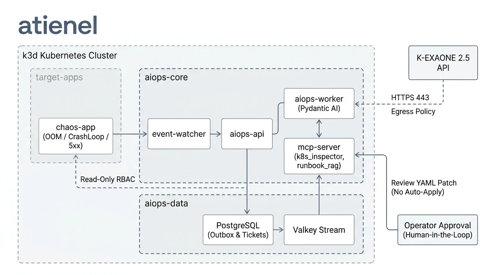

# Atienel

Atienel은 Kubernetes의 OOMKilled, CrashLoopBackOff, HTTP 5xx 급증을 감지해 장애 티켓을 만드는 프로젝트다.

비동기 워커는 읽기 전용 MCP에서 Pod 상태·로그·이벤트와 런북 근거를 수집하고, LLM으로 진단 리포트를 작성한다.

대상과 현재 설정, 관측 원인, 인용이 일치할 때 검토용 YAML을 제안한다. 담당자는 리포트를 읽고 승인 API로 결정과 승인 시각을 남긴다.

## 시스템 아키텍처



구성 요소의 배치 개요다. 실제 요청과 데이터 흐름은 아래와 같다.

- `target-apps`의 재현 워크로드를 `aiops-core`의 `event-watcher`가 관측한다. `aiops-api`는 티켓과 outbox 작업을 저장하고 Valkey 발행을 확인한 뒤 `202 Accepted`를 반환한다.
- `aiops-data`에는 PostgreSQL과 Valkey가 있다. API와 복구 프로세스가 Stream에 발행하고, 워커가 Consumer Group으로 작업을 받아 MCP에 조회한다. 워커는 리포트를 PostgreSQL에 저장한다.
- `mcp-server`는 `target-apps`의 Pod·로그·이벤트를 조회하는 읽기 전용 RBAC를 사용한다. 제공자 모드에서는 워커가 HTTPS 443으로 모델 API를 호출하며 Egress NetworkPolicy가 목적지 CIDR을 제한한다.
- 담당자는 `aiops-api`에서 리포트를 조회하고 승인한다. 승인은 티켓 상태와 승인 이력을 기록하며, YAML은 검토용 산출물로 보존한다.

## 핵심 검증 결과

| 항목 | 로컬 검증 결과 |
| --- | --- |
| SC-001 감지 | 실제 장애 3종을 각각 10회 재현해 관측 시점부터 30초 안에 30/30건 발행 |
| SC-002 접수·멱등성 | 워커를 중지한 상태에서 신규 30건과 재전송 150건 검증. 신규 접수 최대 28.0ms, 이벤트당 티켓·발행 작업 1개 |
| SC-003 진단·제안 | 접수 DB 시각부터 리포트 저장까지 OOMKilled 11.481s, CrashLoopBackOff 0.164s, Http5xxSpike 0.145s. 모두 런북 인용 3개와 파싱 가능한 선언적 YAML 저장 |
| SC-004 승인 | 티켓 10건에서 승인 기록 보존 확인. 조회 전용 토큰과 OPEN 티켓의 승인 거부, 승인 전후 Deployment 사양 일치 |
| 권한·근거 제한 | 일반 Warning 40건에서 패치 `NULL`과 사유 저장. MCP ServiceAccount의 Deployment 패치 및 Pod 삭제 권한 거부 |
| Phase 5 부하 | 신규 92건 p99 21.92ms, 동일 키 재전송 2,705건 p99 5.54ms, 두 시나리오 오류율 0%. 티켓·작업·리포트 각각 93건, DB 중복 0건 |
| 확장·큐 소진 | API HPA `1 → 2 → 1`. 부하 종료를 확인한 뒤 약 1.40s에 Stream과 PEL이 모두 0인 것을 최초 관측 |
| CI 자동화 | Ruff, pytest, 스크립트 구문 검사, 서비스 이미지 5종 빌드, 임시 k3d 통합 테스트 구성. 로컬 확장 pytest 27개와 actionlint 통과 |

부하와 SC-003 수치는 외부 모델 키 없이 실행하는 `verification` 모드의 측정값이다.
[측정 조건과 전체 결과](tests/validation-results.md)

## 빠른 실행

Docker 데몬, `k3d`, `kubectl`, GNU Make, Bash, Python 3.12+, `uv`, OpenSSL이 필요하다.
부하 도구는 Docker 이미지로 실행한다.

### 1. 결정론적 검증 모드

```bash
make k3d-up
make phase1-apply phase1-verify
make phase2-apply phase2-verify
make phase3-apply phase3-verify
DIAGNOSIS_MODE=verification make phase4-apply
make phase4-verify
PHASE5_PROFILE=1 make phase5-load
PHASE5_SLO=1 make phase5-verify
make phase5-ci
```

Phase 2 검증은 워커를 배포하기 전에 실행한다. 부하와 통합 테스트는 클러스터의 재현용 워크로드에 장애를 발생시킨다.

### 2. 실제 모델 연동 모드

로컬 `secrets/phase4-llm.env`에 아래 형식으로 값을 넣는다. 예시 키는 더미 값이며, 이 경로는 Git과 Docker 빌드 컨텍스트에서 제외된다.

```dotenv
LLM_API_KEY=replace-with-provider-key
LLM_MODEL=k-exaone_v2.5
LLM_BASE_URL=https://api.exaone.ai/v1
```

```bash
DIAGNOSIS_MODE=provider PROVIDER_CIDR=34.160.0.0/16 make phase4-apply
make phase4-verify
```

예시 CIDR은 기존 K-EXAONE 연동에서 검증한 범위다. 배포 전 현재 엔드포인트 주소와 허용 범위를 대조한다. 부하 테스트는 1번 모드로 전환한 뒤 실행한다.

### 3. 클러스터 정리

```bash
make k3d-down
```

`atienel` 클러스터와 클러스터 내부의 로컬 데이터가 삭제된다.

## 저장소 안내

| 경로 | 내용 |
| --- | --- |
| [services/](services/) | 재현 앱, 감시자, 접수 API, 진단 워커, MCP 서버 |
| [packages/shared/](packages/shared/) | REST·Stream 공통 계약 |
| [k8s/](k8s/) | 매니페스트, RBAC, 네트워크 정책, DB 초기화 및 검증 스크립트 |
| [data/runbooks/](data/runbooks/) | 런북·회고와 임베딩 시드 매니페스트 |
| [tests/load/](tests/load/) · [tests/profiling/](tests/profiling/) | k6 부하 시나리오와 py-spy 프로파일링 |
| [tests/validation-results.md](tests/validation-results.md) | 부하·수용 기준·SC-003 재검증 결과 |
| [docs/portfolio.md](docs/portfolio.md) | 설계 판단과 장애 해결 기록 |
| [Quickstart](specs/001-aiops-incident-diagnosis/quickstart.md) · [CI](.github/workflows/ci.yml) | 단계별 실행 절차와 자동화 워크플로우 |
