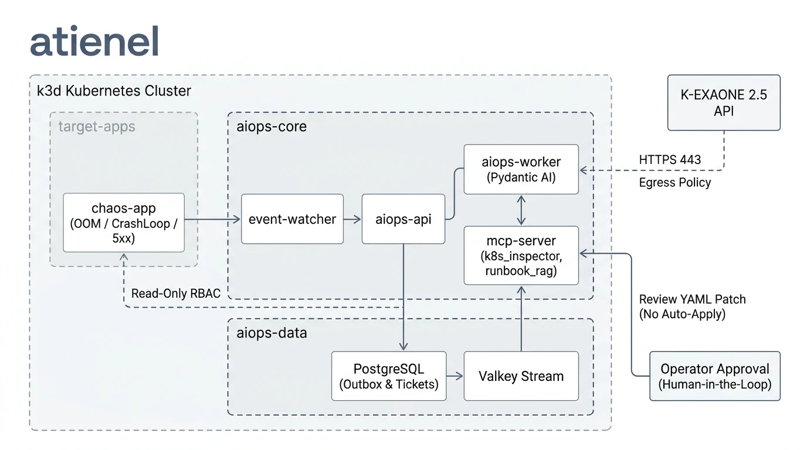

# Atienel 엔지니어링 포트폴리오

## 1. 프로젝트 한눈에 보기

Kubernetes 장애의 초기 증거는 Pod 재시작 이후 사라질 수 있고, 장애 접수와 LLM 진단에 필요한 시간은 다르다. Atienel은 접수 응답을 모델 지연과 분리하고, 담당자가 어떤 근거를 바탕으로 조치를 검토했는지 티켓에 남긴다.

- **접수와 복구**. FastAPI가 PostgreSQL에 티켓과 outbox 작업을 기록한다. API와 복구 프로세스가 Valkey Stream에 발행하고, 진단 워커가 Consumer Group에서 소비한다. 같은 멱등 키는 이전 응답을 재생하고, 재전달된 작업은 DB 작업 ID와 상태를 기준으로 처리한다.
- **읽기 전용 조사**. 워커가 HTTPS Streamable HTTP `/mcp`로 Pod와 런북 근거를 조회한다. MCP는 대상 네임스페이스의 읽기 전용 RBAC와 DB 조회 역할을 사용한다. 외부 모델 접근은 워커의 HTTPS Egress 정책으로 제한한다.
- **사람 승인**. 워커가 구조화 진단을 검증한 뒤 리포트를 저장하고 티켓을 `NEEDS_REVIEW`로 바꾼다. 담당자는 API에서 리포트를 조회하고 승인하며, 첫 승인자와 시각이 트랜잭션에 남는다.
- **기술 스택**. Python 3.12, FastAPI, psycopg, PostgreSQL 16, pgvector·pgvectorscale, Valkey Streams, FastMCP 4.2.6, LangGraph 1.2.24, Pydantic AI 2.0.0, K-EXAONE 2.5, k3d, k6, py-spy, GitHub Actions.

[설계 결정](../specs/001-aiops-incident-diagnosis/research.md) · [REST 계약](../specs/001-aiops-incident-diagnosis/contracts/rest.md) · [Stream 계약](../specs/001-aiops-incident-diagnosis/contracts/stream.md)

## 2. 핵심 트러블슈팅

### 2.1 네트워크 격리와 외부 LLM 연결

**문제와 원인**. 제공자 호출이 `ModelAPIError`로 실패했다. 기본 제한 정책 아래에서 워커의 제공자 Egress 규칙이 비어 있으면 외부 HTTPS 연결이 차단됐다.

**해결과 검증**. 제공자 모드에서만 워커를 선택하는 `phase4-worker-provider` 정책을 구성했다. 연동 당시 `34.160.0.0/16`의 TCP 443을 허용했고, 파드에서 모델 API의 HTTP 200을 확인했다. 다른 클러스터 통신은 기존 내부 정책을 따른다. [배포 스크립트](../k8s/phase4.sh)

### 2.2 추론 시간과 구조화 출력

**문제와 원인**. K-EXAONE 2.5의 기본 추론 강도로 실행 시간을 소진해 워커의 90초 제한에서 `TimeoutError`가 발생했다. 제공자의 응답에는 별도 `reasoning_content`가 포함되며, 도구 호출형 출력 요청에서도 재시도를 관측했다.

**해결과 검증**. `reasoning_effort="low"`와 `PromptedOutput(Diagnosis)`를 사용해 최종 응답을 Pydantic으로 검증했다. 파드에서 실행한 소규모 JSON 진단 요청은 12.5초에 스키마 검증을 통과했다. 실제 모델의 OOM 진단은 PostgreSQL에 저장됐고, 접수된 티켓을 재개해 승인과 중복 전달 검증을 완료했다. 새 티켓을 처음부터 검증하는 동안에는 대기 작업과 제공자의 429로 대기 한도를 넘긴 사례가 있었다. 아래 성능 수치는 외부 제공자 지연과 분리한 verification 결과다. [진단 코드](../services/aiops-worker/src/agent.py) · [티켓 재개 절차](../specs/001-aiops-incident-diagnosis/quickstart.md)

### 2.3 근거가 부족한 YAML 차단

**문제와 원인**. 장애 유형과 Pod 로그만으로 워크로드 대상이나 현재 설정을 확정하기 어려워, 초기 verification 모드는 대표 장애에도 패치 대신 사유를 저장했다.

**해결과 검증**. `k8s_inspector`에 Pod UID, 제어 소유자, 현재 요청량·한도, 이미지, 프로브 유무, fixture의 볼륨·스위치 근거를 추가했다. 명시된 템플릿 표식과 앱 라벨, ReplicaSet 이름 및 해시가 일치할 때 Deployment 이름을 추론한다. 검토용 YAML은 확인된 대상·설정·장애 근거와 해당 런북 절을 모두 요구하며, 저장 전 허용된 선언과 대조한다. 대표 3종의 YAML 검사와 일반 Warning 40건의 `NULL` 처리를 검증했다. [MCP 계약](../specs/001-aiops-incident-diagnosis/contracts/mcp.md) · [패치 규칙](../services/aiops-worker/src/patch_proposals.py)

### 2.4 GitHub Actions의 k3d 초기화 타이밍

**문제와 원인**. CI 러너에서 k3d 클러스터가 생성된 직후 `rollout status deployment/metrics-server`를 실행하면 Deployment가 아직 생성되지 않아 `NotFound`가 발생할 수 있었다.

**해결과 검증**. `k3d-up`에서 2초 간격으로 최대 60회 Deployment의 생성을 확인한 뒤 rollout 준비 상태를 검사하도록 순서를 분리했다. 통합 CI와 로컬 환경은 같은 `make k3d-up` 진입점을 사용한다. 로컬 확장 pytest 27개와 actionlint를 통과했고, 수정 커밋 `a47937f`의 GitHub Actions도 성공했다. [CI 실행 기록](https://github.com/hyukvoid/atienel/actions/runs/46020085391) · [Makefile](../Makefile) · [CI 워크플로우](../.github/workflows/ci.yml)

## 3. 정량 성과

| k6 시나리오 | 202 건수 | 평균 성공 RPS | p50 | p95 | p99 | 오류율 |
| --- | ---: | ---: | ---: | ---: | ---: | ---: |
| A 신규 병렬 인입 | 92 | 1.58 | 9.93ms | 12.25ms | 21.92ms | 0% |
| B 동일 키 재전송 | 2,705 | 46.51 | 3.58ms | 4.52ms | 5.54ms | 0% |

재전송 준비 요청을 포함한 논리 이벤트 93건이 티켓·작업·리포트 각각 93건과 일치했다. 중복은 0건이었다. API HPA는 `1 → 2 → 1`로 동작했고, 부하 종료 확인 후 약 1.40초에 Stream과 PEL이 모두 0임을 최초 관측했다.

| 수용 기준 | 결과 |
| --- | --- |
| SC-001 | 실제 장애 유형당 10건, 총 30건을 관측 후 30초 이내 발행 |
| SC-002 | 워커 중지 중 신규 30건과 재전송 150건. 신규 접수 최대 28.0ms, 이벤트당 티켓·작업 1개 |
| SC-003 | OOMKilled 11.481s, CrashLoopBackOff 0.164s, Http5xxSpike 0.145s에 리포트 저장. 각 인용 3개, YAML 파싱과 대상·변경값 검증 통과 |
| SC-004 | 티켓 10건의 승인 재시도에서 최초 승인 기록 유지. 권한 부족 및 OPEN 티켓의 승인 거부, 승인 전후 Deployment 사양 일치 |

[검증 데이터와 재현법](../tests/validation-results.md)

## 4. 설계상 제약과 확장 지점

- **조치 권한의 경계**. YAML 제안에는 관측 당시 설정과 인용을 연결한다. 현재 설정이나 노드 여유는 시간이 지나면 달라질 수 있으므로 담당자가 대상과 변경 영향을 다시 확인한 뒤 별도 절차에서 적용한다. 승인 API가 저장하는 결과는 티켓 상태와 승인 이력이다.
- **멀티 클러스터**. 현재는 로컬 단일 k3d를 대상으로 한다. 확장 시 이벤트와 승인 범위에 클러스터 식별자를 포함하고, 클러스터별 읽기 전용 자격증명과 관측 경로를 분리하는 방안을 검토할 수 있다.
- **알림 채널**. `NEEDS_REVIEW` 전이를 기준으로 알림 작업을 비동기로 발행할 수 있다. 알림은 승인 API로 연결하고, 기존 승인 권한 검증과 감사 기록은 같은 경계에서 유지한다.
